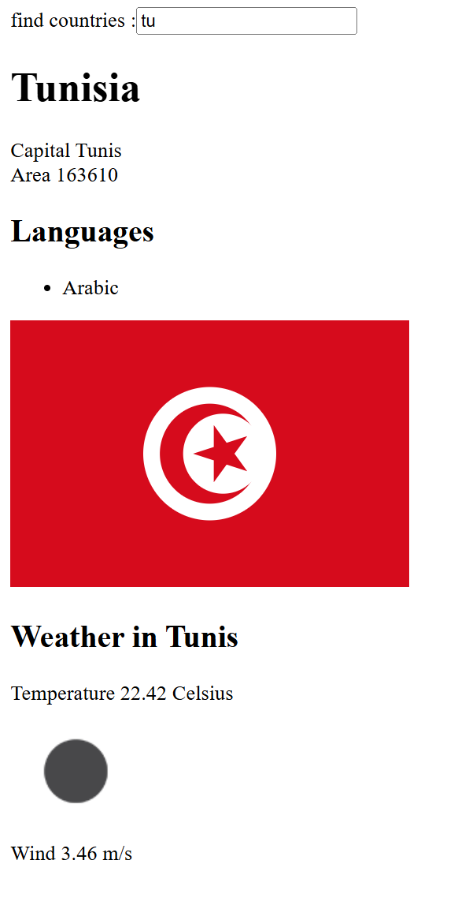

## Project Structure

```text
├── src/
│   ├── components/     # Reusable UI components
│   ├── services/       # API calls, data fetching, and business logic helpers
│   ├── styles/         # Additional stylesheets and theme rules
│   ├── App.css         # Component/layout styles for App
│   ├── App.jsx         # Root application component
│   ├── index.css       # Global styles
│   └── main.jsx        # Application entry point
├── .gitignore
├── eslint.config.js
├── index.html
├── package.json
├── README.md
└── vite.config.js
```

# Country Info App

A single-page application built with React and Vite that allows users to search for countries and view key details, alongside current weather conditions in each capital city, using data from the REST Countries and OpenWeatherMap APIs.

# countries

<p align="center">
  
</p>

# What I Learned

- **Component-based architecture:** the UI is split into small, reusable components (`App`, `Search`, `Countries`, `Country`, `Weather`), each with one job.
- **Props and lifting state up:** `App` owns the shared state (countries, search value, matches) and passes data and handlers down to children.
- **Services layer:** API calls live in `services/` (`countriesService`, `weatherService`) instead of inside components, using Axios and promises.
- **Hooks:** `useState` for state and `useEffect` for fetching data, with dependency arrays so effects re-run when the selected country changes.
- **Conditional rendering:** showing a match list, a single country, or a message depending on the search results.
- **Environment variables:** keeping the API key in a `.env` file (`import.meta.env.VITE_WEATHER_KEY`) and out of git.
- **Working with external APIs:** handling arrays, optional data, and loading states from REST Countries and OpenWeatherMap.

## Setup

1. Install dependencies:
   ```bash
   npm install
   ```
2. Get a free API key at https://home.openweathermap.org/api_keys (new keys can take up to a couple of hours to activate).
3. Create a `.env` file in the project root (next to `package.json`):
